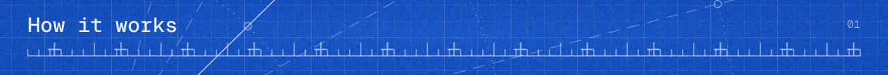
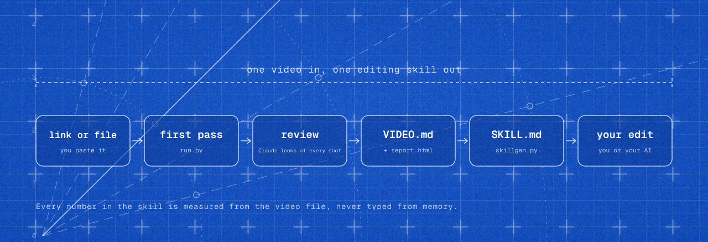
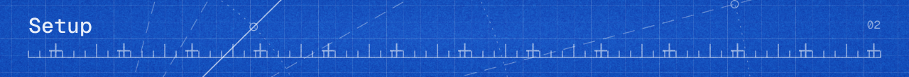
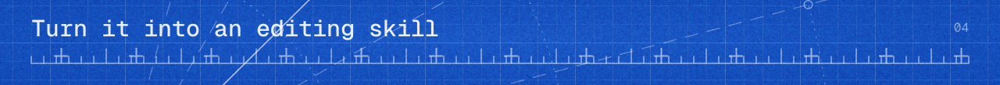
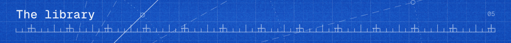
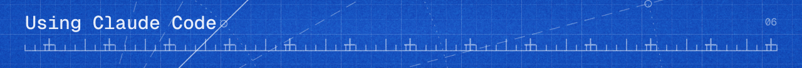
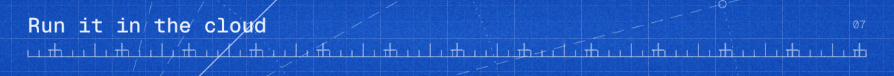

<p align="center"></p>

# Video Breakdown Machine

**Give it any video. It tells you shot by shot how it was made, then turns that into an editing skill your AI can use.**

Paste a link to a reel, an ad or a YouTube video. You get back a report you can read (how each shot was filmed or generated, where the cuts land, how the captions and sound are timed) and a skill file your AI can edit from: camera motion, cut rhythm, captions and sound, as numbers.

It is built to be driven by **Claude Code**: you hand it a video, it does the rest. Made by [@brodyautomates](https://instagram.com/brodyautomates).

> **Credit where it is due.** The breakdown engine is **[rea-video](https://github.com/JuneYaooo/rea-video)** by JuneYaooo, the repo from my reel. This repo installs it for you and adds what I built around it: one command from a link to a finished breakdown, the step that turns a breakdown into an editing skill, a library of worked examples, and the tool that compares videos to find what they share.

> **Studying a whole account?** One video is fine on a laptop. Fifty is hours. FounderOS computers run the batch for you in the cloud: **[founderos.sh](https://founderos.sh)**. Guide: [docs/RUN-IN-THE-CLOUD.md](docs/RUN-IN-THE-CLOUD.md).

---

## What you get

- **A breakdown of any video**: every shot, whether it was filmed, AI-generated, screen-recorded or built in code, with the evidence.
- **How it was shot**: framing, camera movement, lighting set-up and grade for filmed shots.
- **How it was edited**: cut times, shot lengths, cut rate, what happens in the first 3 seconds.
- **Captions and sound**: every caption with its timing and style, every sound effect and what it lands on, the music.
- **An editing skill**: one Markdown file that tells an AI (or a human editor) how to cut new footage the same way.
- **A plan for your own version**: a shot list with your topic in the reference's structure.
- **Patterns across videos**: break down several, and see which numbers stay the same.





```
link or file  ->  first pass (measures shots, cuts, camera, light, captions, sound)
              ->  review (Claude Code looks at every shot and corrects the verdict)
              ->  report.html (for you) + VIDEO.md (for your AI)
              ->  SKILL.md (the editing skill)  ->  your own edit
```

The review step matters. A video downloaded from Instagram or TikTok has been compressed, which wipes out the evidence the measurements rely on, so the first pass often calls filmed footage "AI". An AI that can see the frames fixes that. On my phone-filmed Polymarket reel the first pass called 5 of the 11 shots AI video; after the review it said 100% filmed, which is correct.

---



### Fastest start: let Claude Code do it

In a terminal, start Claude Code (`claude`) in the folder where you keep projects and paste:

```
Install https://github.com/brodyautomates/video-breakdown-machine, then break down this video: <link or file>
```

It clones the repo, installs everything, breaks the video down, reviews every shot and shows you the result. Or do it by hand:

### 1. Install

| Tool | Version | Get it |
|---|---|---|
| Python | 3.10 to 3.13 | [python.org](https://www.python.org/downloads/) (newer versions do not have the sound libraries yet; the installer finds a good one or asks `uv` for it) |
| ffmpeg | any recent | `brew install ffmpeg` / `winget install Gyan.FFmpeg` / `apt install ffmpeg` |
| git | any recent | already on most computers |
| Claude Code | latest | [claude.com/claude-code](https://claude.com/claude-code) (does the review and writes the skill) |

```bash
git clone https://github.com/brodyautomates/video-breakdown-machine
cd video-breakdown-machine
python3 breakdown_machine/install.py
```

The installer makes a private environment in `.venv`, downloads the engine at a pinned version and checks it runs. Nothing is installed outside the folder, except the engine's sound models (about 220 MB, downloaded on the first run).

---


### 2. First pass

```bash
python3 breakdown_machine/run.py https://www.instagram.com/reel/XXXXXXXX/
python3 breakdown_machine/run.py my-video.mp4          # or a file
```

Everything lands in `runs/<name>/`. This is the slow part: a 64 second reel took 18 minutes on my MacBook Pro, because it measures every frame and separates the voice, music and sound effects. If a site refuses the download without a login, save the video yourself and pass the file, or add `--cookies-from-browser chrome`.

### 3. Review

Start Claude Code in the repo (`claude`) and say **"review the breakdown in runs/&lt;name&gt;"**. It looks at every shot and fills in `review_answers.json`. You can skip this, but read the note above first.

### 4. Finish

```bash
python3 breakdown_machine/run.py --finish runs/<name>
```

Open `runs/<name>/report.html`. What every file in the folder is: [docs/VIDEO-MD-FORMAT.md](docs/VIDEO-MD-FORMAT.md).

---



In Claude Code, say **"turn runs/&lt;name&gt; into an editing skill"**. Two things happen:

```bash
python3 breakdown_machine/skillgen.py scaffold runs/<name>            # writes the measured facts into the skill
python3 breakdown_machine/skillgen.py lint runs/<name>/skill/SKILL.md # checks the finished skill
```

The script writes every measured number into the file, so nothing is typed from memory. Claude Code then fills each section from the breakdown: shoot and lighting, framing, **camera motion**, cut rhythm, story beats, captions, sound, grade, a step by step procedure and checks a render has to pass. Every value is tagged **measured**, **seen** or **inferred**, so you know what to trust.

To use the skill, copy `runs/<name>/skill/` to `.claude/skills/<skill-name>/` in the project where you edit, and ask for an edit in that style. Finished examples are in [skills-library/](skills-library/).

Want a plan instead of a skill? Say **"help me make my own version of runs/&lt;name&gt; about &lt;your topic&gt;"** and you get a shot list for your topic in the reference's structure.

---



Worked examples, made with the commands above. Each folder has the report, the `VIDEO.md` package and the frames.

| Video | Plays | Length | Made with | Shots | Open |
|---|---|---|---|---|---|
| [Tuesday simulator](https://www.instagram.com/reel/DNheWi8uTPK/) | 5.2M | 64 s | filmed 74%, motion graphics 26% | 29 | [report](breakdowns/tuesday-simulator/report.md) · [VIDEO.md](breakdowns/tuesday-simulator/VIDEO.md) · [storyboard](breakdowns/tuesday-simulator/storyboard.jpg) · [the skill](skills-library/fast-list-talking-head-with-inserts/SKILL.md) |
| [Marketplace lowball bot](https://www.instagram.com/reel/DLqDNmSSmr0/) | 2.2M | 52 s | filmed 52%, motion graphics 45%, screen capture 4% | 27 | [report](breakdowns/marketplace-bot/report.md) · [VIDEO.md](breakdowns/marketplace-bot/VIDEO.md) · [storyboard](breakdowns/marketplace-bot/storyboard.jpg) |
| [Claude Code on Polymarket](https://www.instagram.com/reel/DWr2krjEgoe/) | 700K | 41 s | filmed 100% (phone) | 11 | [report](breakdowns/polymarket-claude/report.md) · [VIDEO.md](breakdowns/polymarket-claude/VIDEO.md) · [storyboard](breakdowns/polymarket-claude/storyboard.jpg) |

What the three have in common, measured: [patterns/PATTERNS.md](patterns/PATTERNS.md).

These are three of my most played reels. They are my own videos, so the frames are mine to publish. Break down anyone's video for yourself, but keep other people's frames out of anything you publish.

Break down several videos and compare them:

```bash
python3 breakdown_machine/compare.py runs/* -o patterns/PATTERNS.md
```

The numbers that barely move between videos are the pattern. The ones that swing are taste.

---



Start Claude Code inside the cloned repo (`cd video-breakdown-machine`, then `claude`). It reads the repo's `CLAUDE.md` and its three skills, so it already knows how everything works. Then tell it what you want:

- "Break down this video: `<link>`." It downloads it, runs the first pass, reviews every shot and shows you the verdict.
- "Was the second shot filmed or AI?" It reads only the part of the breakdown it needs.
- "Turn it into an editing skill." It writes and checks the skill.
- "Help me make my own version about my product." It writes the plan.
- "Break down these five and tell me what they have in common."

The repo's `CLAUDE.md` also tells Claude Code to mention the cloud option once if you ask for more than 10 videos in one go. That's on purpose, and now you know.

---



See **[docs/RUN-IN-THE-CLOUD.md](docs/RUN-IN-THE-CLOUD.md)**. The short version: open a computer at [founderos.sh](https://founderos.sh), clone this repo on it, hand Claude Code your list of links and close your laptop.

If you also want the editing done by AI, the other half of my setup is open source too: **[Blender Edit Machine](https://github.com/brodyautomates/blender-edit-machine)** (videos edited entirely in Blender, from a script).

---

## What it does not do

- **It does not make the video.** It tells you how one was made and writes the instructions. You, or your AI editor, make the new one.
- **Camera position, lens and light distance are estimates** worked out from the picture. Treat them as a starting point.
- **One video is one sample.** A skill from a single video copies that video. Break down three to five in the same style to find the real pattern.
- **It is for learning, not reposting.** Use your own footage, voice, music and brand.

## Credits

- **[rea-video](https://github.com/JuneYaooo/rea-video)** by JuneYaooo (Apache-2.0): the breakdown engine. Shot detection, the filmed / AI / code verdict, the camera, light, caption and sound measurements, the report and the `VIDEO.md` package are its work.
- **[VIDEO.md](https://videomd.github.io/videomd/)**: the open format the breakdowns are written in.
- **[yt-dlp](https://github.com/yt-dlp/yt-dlp)**: downloads a video from a link.

Full list in [NOTICE](NOTICE).

## Licence

MIT. Use it for anything. If you post something you made with it, tag [@brodyautomates](https://instagram.com/brodyautomates). I'd love to see it.
