# How this video was made: polymarket-claude.mp4

**In one line**: A phone-filmed walk-through of a trading dashboard on a real laptop, followed by a selfie explanation. Nothing is screen-recorded or animated; the proof is a finger on a real screen.
**How it was made**: Mixed production: live action 100%

- 0:41 · vertical 9:16 · 11 shots, 3.8s each on average
- Confidence 73%, based on: tool measurements + AI assistant reviewed 11 shots
- ⚠️ 3 points are uncertain, see “Open questions”

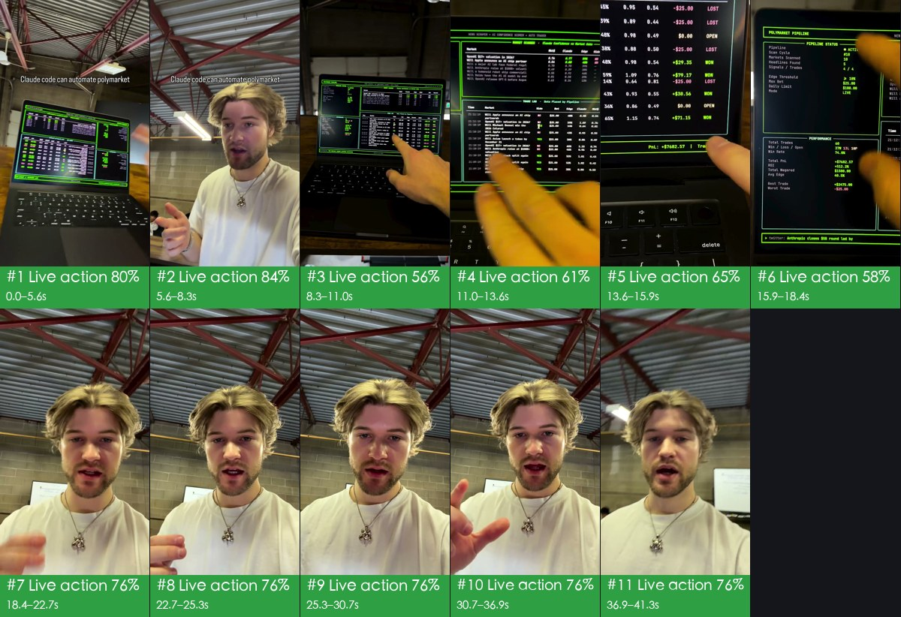

# Part one · Breakdown: how this video is built

## What makes it work

- **The hook**: 0 to 5.6 s: the first shot is the dashboard itself, running on a laptop, with one small caption stating the claim. The face does not appear until 5.6 s.
- The product is on screen for the first 5.6 s and for 13 of the first 18 s: the viewer sees the thing before hearing about it
- The screen is filmed by hand with a finger pointing at rows (8.3 to 18.4 s), which reads as real in a way a clean screen recording does not
- After the proof, one selfie take of 23 s is cut into five pieces: no b-roll, no graphics, the pace comes from the jump cuts
- One static caption line at the top for the first 8 s instead of word-by-word captions

## Production pipeline at a glance

| Stage | What this video uses | Remake approach |
|---|---|---|
| **Base picture** | live action 11 shots (100%); includes real material in 11 shots (100%) | filmed in 1 scene |
| **Packaging** | styled text ×2 (green fill, multi-colour / gradient, thick outline, large size, tilted, orange fill): "024.03", "6"; text label ×310 (18 of them follow an object): "Claude code ca", "21:09:19", "21:18:19", "4-04-0521:31:5", "/1", "Liait" …; counter ×26: "26% 6%", "0.63", "+$22.17", "8.89", "+$22.17", "0" … | export `packaging/overlays.ass` for timeline alignment |
| **Sound** | voice（human recording） | voice: record it yourself |

## Content and structure

- The narrative line below comes from reading each shot; the lines were not transcribed separately, subtitle text is under “Packaging layer”

**Narrative line**

Keep this line in a remake: same order, same job at each step, with the point refilled from your own cases, numbers and material, so it is more than a change of subject.

| Time | Shots | Job | What it says |
|---|---|---|---|
| 0.0–8.3s | #1, #2 | grab attention | Open on the finished tool running on a real screen, with the claim as a one-line caption → Cut to the face straight after the product shot to make the claim personal |
| 8.3–15.9s | #3–#5 | show evidence | Walk through the real screen with a finger instead of a screen recording → Move closer on the detail being explained → Show results as numbers on the real screen |
| 15.9–30.7s | #6–#9 | add information | Show the settings panel to explain how it runs → Back to the face for the explanation → Keep the explanation moving with jump cuts → Continue the explanation |
| 30.7–36.9s | #10 | turn | A gesture toward the lens to mark the condition or warning |
| 36.9–41.3s | #11 | call to action | Close on the face with the offer |

## Shot list

| # | Frame | Time | What it says | Picture | Camera |
|---|---|---|---|---|---|
| 1 | 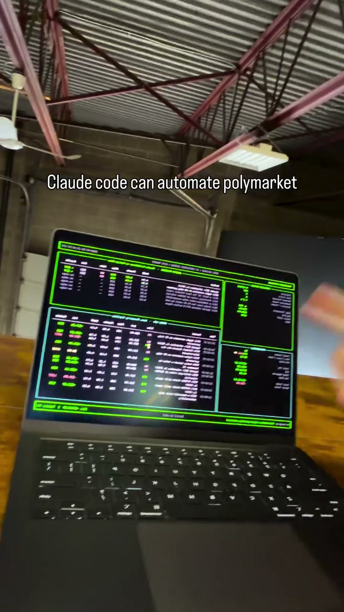 | 0:00.0 · 5.6s | grab attention: Open on the finished tool running on a real … | Handheld phone shot looking down at an open laptop on a wood… | handheld shake |
| 2 | 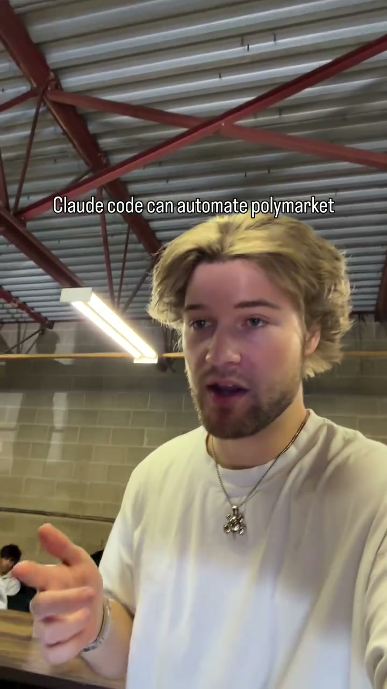 | 0:05.6 · 2.7s | grab attention: Cut to the face straight after the product s… | Selfie in a warehouse space: the presenter talks to the lens… | smooth move |
| 3 | 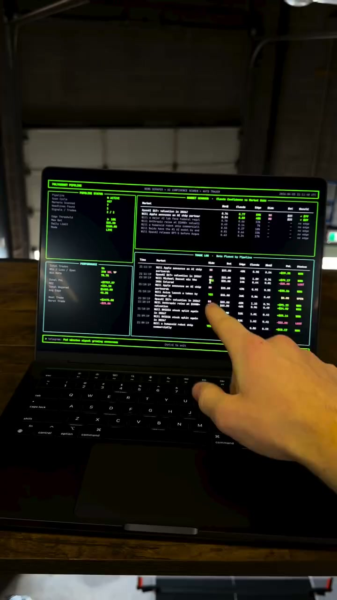 | 0:08.3 · 2.7s | show evidence: Walk through the real screen with a finger in… | Handheld phone shot of the laptop screen from above the keyb… | smooth move |
| 4 | 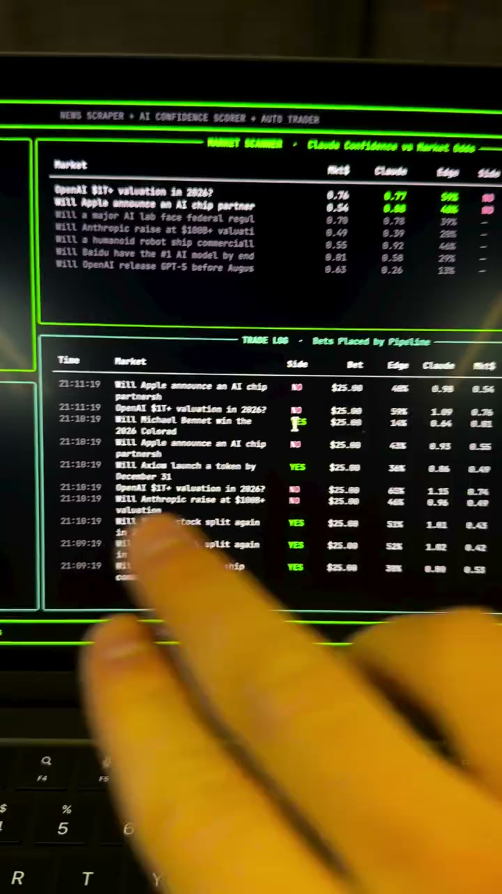 | 0:11.0 · 2.6s | show evidence: Move closer on the detail being explained | Closer handheld shot of the dashboard table; his finger swee… | smooth move |
| 5 | 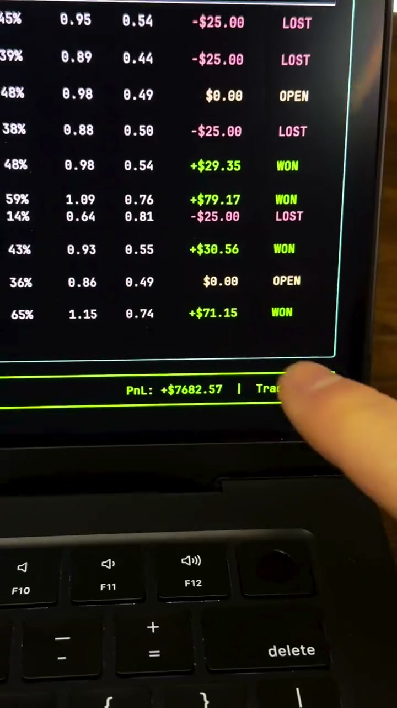 | 0:13.6 · 2.3s | show evidence: Show results as numbers on the real screen | Very close handheld shot of the right side of the table: per… | smooth move |
| 6 | 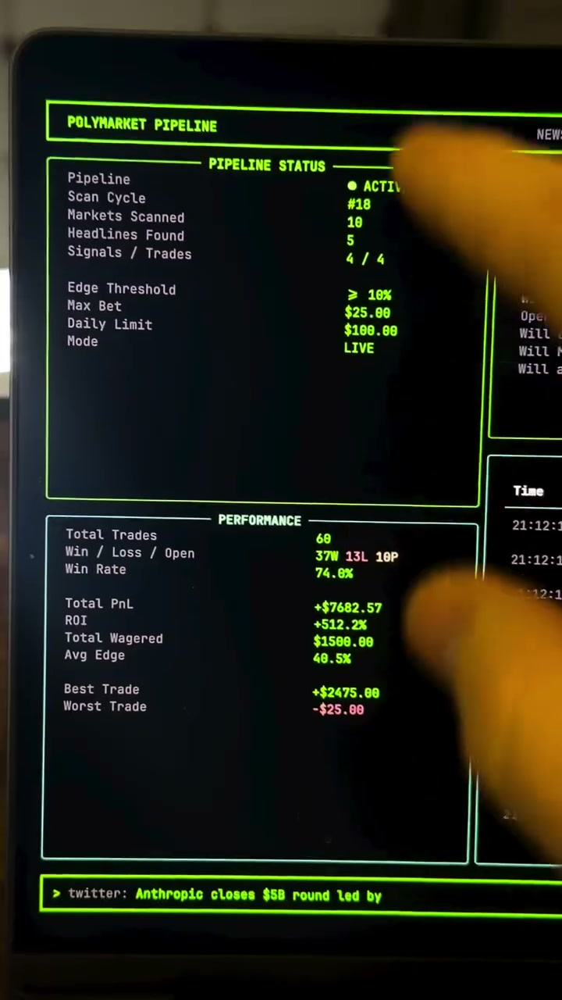 | 0:15.9 · 2.5s | add information: Show the settings panel to explain how it r… | Close handheld shot of the left panel of the dashboard (pipe… | smooth move |
| 7 | 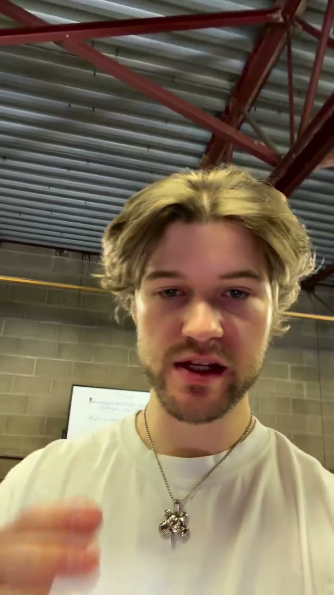 | 0:18.4 · 4.4s | add information: Back to the face for the explanation | Selfie, closer than before: the presenter talks to the lens,… | smooth move |
| 8 | 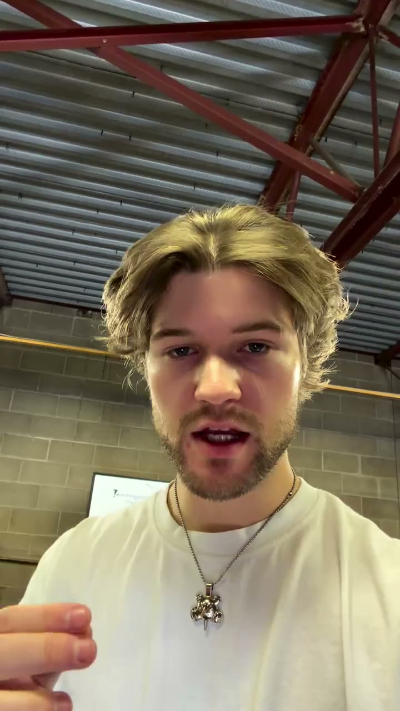 | 0:22.7 · 2.6s | add information: Keep the explanation moving with jump cuts | Same selfie framing, a jump cut later in the take. | smooth move |
| 9 | 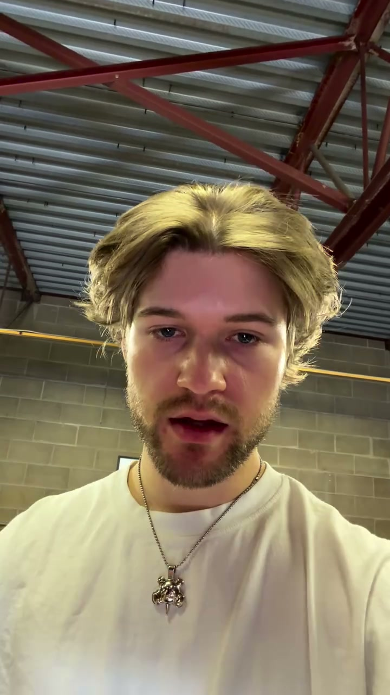 | 0:25.3 · 5.4s | add information: Continue the explanation | Same selfie framing, continuing. | smooth move |
| 10 | 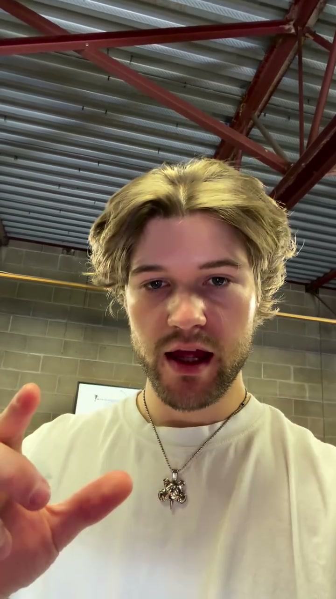 | 0:30.7 · 6.2s | turn: A gesture toward the lens to mark the condition or war… | Same selfie framing; his open hand comes up toward the lens. | smooth move |
| 11 | 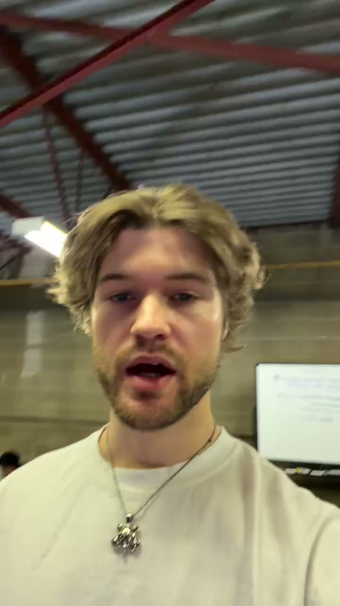 | 0:36.9 · 4.3s | call to action: Close on the face with the offer | Same selfie framing for the closing line. | smooth move |

## Cast, scenes and props

- **Visual style**: Raw phone footage in available light, no graphics. A dark terminal-style dashboard on a laptop is the only designed element.

| Id | Name | Kind | Look | Role | Voice | Shots |
|---|---|---|---|---|---|---|
| A | Presenter | person | Man in his twenties, wavy blond-brown hair to the jaw, short beard, plain white tee, a metal pendant on a chain | Narrator; on camera in the selfie shots, his hand in the screen shots | — | #2, #7–#11 |

- Character consistency: Presenter appear across multiple shots; lock an anchor image first and feed it as reference in later shots

**Scenes**

| Scene | Where | When | Set / light | Shots |
|---|---|---|---|---|
| S1 | Warehouse or industrial gym space: corrugated roof, red steel trusses, brick wal | Daytime, interior | Flat available light | #1–#11 |

**Props / products / logos**

- Laptop with the dashboard (shots #1, #3–#6): Dark terminal-style trading dashboard, green and magenta text

## Camera and lighting

- Framing: shot size close-up 62%, medium shot 20%, medium close-up 18%; subject is a face (shot size from face height)
- Camera: moving camera (gimbal / handheld pan) 86%, handheld 14%; typical move pan / track
- Lighting: Available light only: overhead industrial fixtures and daylight in a warehouse space. The laptop screen lights itself. (image reading; pixel measurements in the fold below)
- Grade: natural (close to the original colours); normal saturation, normal contrast, normal blacks, overall neutral
- Format: talking head (face as subject 62%, objects / hands as subject 38%, handheld 100%); image readers: Phone-filmed demo: a real screen walked through by hand, then a selfie explanation

Per-item measurements and image readings (11)

| Aspect | Item | Verdict | Sources |
|---|---|---|---|
| Framing | shot size | close-up | measured |
| Camera | camera support | moving camera (gimbal / handheld pan) | measured |
| Camera | set-ups / locations | Two set-ups in one room: a handheld phone filming a laptop screen (shots 1 and 3 to 6) and a handheld selfie (shots 2 and 7 to 11). | agent review |
| Camera | likely gear | One phone. Rear camera for the laptop shots, front camera at arm's length for the selfie. A guess from the perspective and the arm in frame. | agent review |
| Lighting | soft / hard | soft light (wide lit-to-shadow ramp) | measured |
| Lighting | colour temperature | warm (about 3000–4000K) | measured |
| Lighting | overall lighting | Available light only: overhead industrial fixtures and daylight in a warehouse space. The laptop screen lights itself. | agent review |
| Grade | colour grade | natural (close to the original colours) | measured |
| Grade | overall grade | Ungraded phone footage: natural, slightly warm skin against a grey and red roof. | agent review |
| Editing | editing style | Product first, then face. Six shots on the real screen in the first 18 seconds, then one selfie take cut into five pieces with jump cuts. Hard cuts only, no graphics. | agent review |
| Format | video format | Phone-filmed demo: a real screen walked through by hand, then a selfie explanation | measured: talking head; agent review |

- Note: lighting ratio, soft / hard, colour temperature and shot size are measured on the subject's pixels (the face when there is one, otherwise the in-focus region, which is an estimate); platform transcodes crush the shadows, so hardness and fill read conservative; camera angle, light source, catchlight and rim light follow the image readers. Where measurement and readers disagree, both are listed.

## Packaging layer (subtitles / styled text / stickers / sound-effect hits)

- styled text ×2 (green fill, multi-colour / gradient, thick outline, large size, tilted, orange fill): "024.03", "6"
- text label ×310 (18 of them follow an object): "Claude code ca", "21:09:19", "21:18:19", "4-04-0521:31:5", "/1", "Liait" …
- counter ×26: "26% 6%", "0.63", "+$22.17", "8.89", "+$22.17", "0" …

text timeline (120 rows)

| Time | Kind | Text | Style | In / out | SFX |
|---|---|---|---|---|---|
| 0.00–8.10s | text label | Claude code can automate polymarket | white text, black outline, line height 3.6% (about 46px) | hard out | — |
| 8.50–8.60s | text label | 21:09:19 | grey text, line height 1.1% (about 14px) | hard in / hard out | — |
| 8.80–10.10s | text label | 4-04-0521:31:5uTc | grey text, line height 1.5% (about 19px) | hard in / fade out | — |
| 9.50–9.60s | text label | /1 | green text, keywords highlighted in green, line height 0.6% (about 8px) | hard in / hard out | — |
| 9.50–9.60s | text label | Liait | black text, keywords highlighted in grey, line height 0.6% (about 8px) | hard in / hard out | — |
| 9.50–9.60s | text label | Tioe | grey text, keywords highlighted in white, line height 0.6% (about 8px) | hard in / hard out | — |
| 9.50–10.60s | text label | 25.0 | white text, line height 1.0% (about 13px) | hard in (bounces / changes colour midway) | — |
| 9.50–9.60s | text label | A.18 | white text, bold, line height 0.5% (about 7px) | hard in / hard out | — |
| 9.50–9.60s | text label | 6.54 | grey text, line height 0.8% (about 10px) | hard in / hard out | — |
| 9.50–9.60s | text label | P | green text, black box, line height 1.7% (about 22px) | hard in / hard out | — |
| 9.50–9.60s | text label | $25.00 ⏎ $25.00 | grey text, keywords highlighted in white, line height 1.1% (about 13px) | hard in / hard out | — |
| 9.50–9.60s | text label | 8.95 ⏎ 8.49 | grey text, black outline, line height 0.9% (about 11px) | hard in / hard out | — |
| 9.50–9.60s | text label | 0.35 | grey text, line height 0.8% (about 10px) | hard in / hard out | — |
| 9.50–9.60s | text label | YES | green text, keywords highlighted in black, line height 0.9% (about 12px) | hard in / hard out | — |
| 9.50–9.60s | text label | 0.06 | white text, bold, line height 0.9% (about 11px) | hard in / hard out | — |
| 9.50–9.60s | text label | $25.0 ⏎ $25.00 ⏎ $25.00 | white text, bold, line height 1.1% (about 14px) | hard in / hard out | — |
| 9.50–9.60s | text label | 1.35 | white text, line height 1.4% (about 18px) | hard in / hard out | — |
| 9.50–9.60s | styled text | 024.03 | green text, green outline, keywords highlighted in green, line height 0.5% (about 7px) | hard in / hard out | — |
| 9.50–9.60s | text label | 1.01 ⏎ 1.02 ⏎ $25.00 | grey text, keywords highlighted in white, line height 0.9% (about 11px) | hard in / hard out | — |
| 9.50–9.60s | text label | 0,43 | white text, bold, line height 0.6% (about 8px) | hard in / hard out | — |
| 9.50–9.60s | text label | 433.14 | green text, keywords highlighted in black, line height 0.9% (about 11px) | hard in / hard out | — |
| 9.50–9.60s | text label | 8,42 | grey text, keywords highlighted in white, line height 0.6% (about 8px) | hard in / hard out | — |
| 9.50–9.60s | text label | -125.0 | red text, bold, line height 0.8% (about 10px) | hard in / hard out | — |
| 9.50–9.60s | text label | 9,33 | grey text, line height 0.6% (about 8px) | hard in / hard out | — |
| 9.50–9.60s | text label | *22.17 | green text, line height 0.8% (about 10px) | hard in / hard out | — |
| 9.50–9.60s | text label | ctrt+t to eit | green text, keywords highlighted in grey, line height 1.0% (about 13px) | hard in / hard out | — |
| 9.50–10.10s | text label | W | grey text, keywords highlighted in grey, line height 0.7% (about 8px) | hard in / fade out | — |
| 9.50–9.60s | text label | D | black text, keywords highlighted in grey, line height 0.5% (about 7px) | hard in / hard out | — |
| 9.50–10.60s | text label | 21:99:19 ⏎ 21:09:19 | grey text, keywords highlighted in grey, line height 1.1% (about 14px) | hard out | — |
| 10.00–10.60s | text label | 21:18:19 | black text, keywords highlighted in grey, line height 1.1% (about 14px) | hard in / hard out | — |
| 10.00–10.30s | text label | OACTTE | green text, keywords highlighted in green, line height 0.8% (about 10px) | hard in / hard out | — |
| 10.00–10.10s | text label | ption | grey text, line height 0.5% (about 6px) | hard in / hard out | — |
| 10.50–10.60s | text label | sipnats / | black text, keywords highlighted in grey, line height 0.7% (about 9px) | hard in / hard out | — |
| 10.50–10.60s | text label | 9,49 | black text, keywords highlighted in grey, line height 0.5% (about 7px) | hard in / hard out | — |
| 10.50–10.60s | text label | 125.00 ⏎ 125.00 | white text, bold, line height 0.7% (about 9px) | hard in / hard out | — |
| 11.00–11.60s | text label | 2026-84 | black text, grey outline, line height 1.6% (about 20px) | type-on / hard out | — |
| 11.00–11.10s | text label | 0.77 ⏎ 0,60 | green text, keywords highlighted in black, line height 1.5% (about 19px) | hard in / hard out | — |
| 11.00–11.10s | text label | 59% ⏎ 48% | green text, bold, line height 1.5% (about 19px) | hard in / hard out | — |
| 11.00–11.10s | text label | 0.54 | white text, line height 1.7% (about 22px) | hard in / hard out | — |
| 11.00–11.10s | text label | NO | red text, line height 1.6% (about 20px) | hard in / hard out | — |
| 11.00–11.60s | text label | 0.82 ⏎ 0.32 ⏎ 0.55 ⏎ 0.39 ⏎ 0.63 | grey text, keywords highlighted in grey, line height 1.4% (about 18px) | hard in | — |
| 11.00–11.10s | text label | 0.82 ⏎ 16% | black text, grey outline, keywords highlighted in grey, line height 1.5% (about 19px) | hard in / hard out | — |
| 11.00–11.60s | text label · follows an object | Time | white text, grey outline, line height 1.3% (about 17px) | type-on / hard out | — |
| 11.00–11.60s | text label · follows an object | Edge | white text, black outline, line height 1.9% (about 25px) | hard in | — |
| 11.00–11.60s | text label · follows an object | Side | white text, black outline, line height 1.3% (about 17px) | hard in | — |
| 11.00–11.10s | text label | Bet ⏎ NO ⏎ $25.00 ⏎ $25.08 ⏎ $25.80 ⏎ 36 | white text, line height 1.5% (about 19px) | hard in / hard out | — |
| 11.00–11.10s | text label | CLaude ⏎ 48% ⏎ 59% ⏎ 14% ⏎ 43% | white text, line height 1.5% (about 19px) | hard in / hard out | — |
| 11.00–11.10s | text label | WitL Apple announce an AI chip ⏎ OpenAI$ | white text, line height 1.7% (about 22px) | hard in / hard out | — |
| 11.00–11.10s | text label | $25.00 ⏎ NO | white text, line height 1.4% (about 18px) | hard in / hard out | — |
| 11.00–11.10s | text label | 0.98 | grey text, line height 1.5% (about 19px) | hard in / hard out | — |
| 11.00–11.10s | text label | 0.54 ⏎ 1.09 ⏎ 0.81 ⏎ 8.93 ⏎ 0.49 ⏎ 0.74  | white text, line height 1.4% (about 18px) | hard in / hard out | — |
| 11.00–11.10s | text label | 8.76 | white text, line height 1.5% (about 19px) | hard in / hard out | — |
| 11.00–11.10s | text label | 0.64 | grey text, line height 1.7% (about 22px) | hard in / hard out | — |
| 11.00–11.10s | text label | 2826Colorad | white text, line height 1.7% (about 22px) | hard in / hard out | — |
| 11.00–11.10s | text label | NO | red text, line height 1.3% (about 17px) | hard in / hard out | — |
| 11.00–11.10s | text label | 0.55 ⏎ 0.86 ⏎ 1.15 | grey text, keywords highlighted in white, line height 1.4% (about 18px) | hard in / hard out | — |
| 11.00–11.10s | text label | YES | green text, keywords highlighted in green, line height 1.4% (about 18px) | hard in / hard out | — |
| 11.00–11.10s | text label | December 31 | white text, line height 1.2% (about 16px) | hard in / hard out | — |
| 11.00–11.10s | text label | NO | grey text, keywords highlighted in white, line height 1.3% (about 17px) | hard in / hard out | — |
| 11.00–11.10s | text label | 0.49 | white text, line height 1.4% (about 18px) | hard in / hard out | — |
| 11.00–11.10s | text label | vaLuation | white text, line height 1.2% (about 16px) | hard in / hard out | — |
| 11.00–11.10s | text label | in2826? | white text, line height 1.3% (about 17px) | hard in / hard out | — |
| 11.00–11.10s | text label | in20267 ⏎ Willa humanoid robot ship ⏎ co | white text, bold, line height 1.3% (about 17px) | hard in / hard out | — |
| 11.00–11.60s | text label · follows an object | Ctrl+Ctoexit | black text, black outline, keywords highlighted in grey, line height 1.4% (about 18px) | slide in / hard out | — |
| 11.00–11.10s | text label | DII ⏎ F9 | grey text, line height 1.4% (about 18px) | hard in / hard out | — |
| 11.00–11.10s | text label | 公 ⏎ F8 | grey text, keywords highlighted in grey, line height 1.4% (about 18px) | hard in / hard out | — |
| 11.00–11.10s | text label | Q | grey text, line height 1.0% (about 13px) | hard in / hard out | — |
| 11.00–11.10s | text label | F4 | grey text, line height 0.9% (about 12px) | hard in / hard out | — |
| 11.00–11.10s | text label | R | black text, grey outline, bold, line height 1.5% (about 19px) | hard in / hard out | — |
| 11.30–11.60s | text label | $2 ⏎ $2 | white text, line height 1.2% (about 16px) | hard in / hard out | — |
| 11.40–11.60s | text label | Hets ⏎ 0.98 ⏎ 59% ⏎ $25.00 ⏎ $25.08 ⏎ 36 | white text, line height 1.5% (about 19px) | hard in / hard out | — |
| 11.40–11.60s | text label | 0.54 ⏎ 1.89 ⏎ 0.64 | grey text, keywords highlighted in white, line height 1.4% (about 18px) | hard in / hard out | — |
| 11.50–11.60s | text label | 0.76 ⏎ 0.54 ⏎ 0.70 ⏎ 0.49 | grey text, line height 1.5% (about 19px) | hard in / hard out | — |
| 11.50–11.60s | text label | $9% ⏎ 48% | green text, line height 1.6% (about 20px) | hard in / hard out | — |
| 11.50–11.60s | text label | NO ⏎ NO | pink text, line height 1.5% (about 19px) | hard in / hard out | — |
| 11.50–11.60s | text label | 0.01 | grey text, line height 1.4% (about 18px) | hard in / hard out | — |
| 11.50–11.60s | text label | will OpenAI release GPT-5 before Augus | grey text, line height 2.1% (about 27px) | hard in / hard out | — |
| 11.50–11.60s | text label | Bet | grey text, keywords highlighted in white, line height 1.4% (about 18px) | hard in / hard out | — |
| 11.50–11.60s | text label | Pnl | white text, line height 1.2% (about 16px) | hard in / hard out | — |
| 11.50–11.60s | text label | WillAppleannounce an AI chip ⏎ OpenAI$iT | white text, line height 1.6% (about 20px) | hard in / hard out | — |
| 11.50–11.60s | text label | NO | grey text, keywords highlighted in white, line height 1.3% (about 17px) | hard in / hard out | — |
| 11.50–11.60s | text label | $25.88 ⏎ NO | white text, line height 1.4% (about 18px) | hard in / hard out | — |
| 11.50–11.60s | text label | -429.35 ⏎ +$79.17 | green text, green outline, line height 1.4% (about 18px) | hard in / hard out | — |
| 11.50–11.60s | text label | $25.80 | black text, white outline, line height 1.4% (about 18px) | hard in / hard out | — |
| 11.50–11.60s | text label | 8.76 | grey text, line height 1.4% (about 18px) | hard in / hard out | — |
| 11.50–11.60s | text label | 14% | white text, line height 1.3% (about 17px) | hard in / hard out | — |
| 11.50–11.60s | text label | 6.81 | white text, line height 1.4% (about 18px) | hard in / hard out | — |
| 11.50–11.60s | text label | -$25.88 | red text, line height 1.2% (about 16px) | hard in / hard out | — |
| 11.50–11.60s | text label | 21:10:19 | grey text, line height 1.3% (about 17px) | hard in / hard out | — |
| 11.50–11.60s | text label | NO | white text, line height 1.3% (about 17px) | hard in / hard out | — |
| 11.50–11.60s | text label | 43% ⏎ 0.86 | white text, line height 1.4% (about 18px) | hard in / hard out | — |
| 11.50–11.60s | text label | 0.93 ⏎ 0.49 ⏎ 1.15 | grey text, line height 1.4% (about 18px) | hard in / hard out | — |
| 11.50–11.60s | text label | 0.55 | grey text, line height 1.4% (about 18px) | hard in / hard out | — |
| 11.50–11.60s | text label | +$30.56 | green text, line height 1.4% (about 18px) | hard in / hard out | — |
| 11.50–11.60s | text label | $25.08 ⏎ NO | grey text, keywords highlighted in white, line height 1.6% (about 20px) | hard in / hard out | — |
| 11.50–11.60s | text label | YES | green text, keywords highlighted in green, line height 1.5% (about 19px) | hard in / hard out | — |
| 11.50–11.60s | text label | $0.00 | yellow text, line height 1.4% (about 18px) | hard in / hard out | — |
| 11.50–11.60s | text label | +$71.15 | green text, line height 1.8% (about 23px) | hard in / hard out | — |
| 11.50–11.60s | text label | $25.00 | grey text, line height 1.4% (about 18px) | hard in / hard out | — |
| 11.50–11.60s | text label | 8.74 | grey text, line height 1.4% (about 18px) | hard in / hard out | — |
| 11.50–11.60s | text label | $25.80 ⏎ 51% | white text, line height 1.4% (about 18px) | hard in / hard out | — |
| 11.50–11.60s | text label | $24.82 ⏎ 433.14 | green text, black box, line height 1.4% (about 18px) | hard in / hard out | — |
| 11.50–11.60s | text label | 849 | white text, line height 1.2% (about 15px) | hard in / hard out | — |
| 11.50–11.60s | text label | valuation | grey text, keywords highlighted in white, line height 1.7% (about 22px) | hard in / hard out | — |
| 11.50–11.60s | text label | YES ⏎ YES ⏎ YES | green text, keywords highlighted in green, line height 1.4% (about 18px) | hard in / hard out | — |
| 11.50–11.60s | text label | 21:10:19 | grey text, line height 1.3% (about 17px) | hard in / hard out | — |
| 11.50–11.60s | text label | 1.01 ⏎ 52% ⏎ 38% | grey text, keywords highlighted in brown, line height 1.4% (about 18px) | hard in / hard out | — |
| 11.50–11.60s | text label | 1.62 | grey text, line height 1.4% (about 18px) | hard in / hard out | — |
| 11.50–11.60s | text label | commercially | white text, line height 1.7% (about 22px) | hard in / hard out | — |
| 11.50–13.10s | text label | F11 | grey text, line height 1.2% (about 15px) | type-on (bounces / changes colour midway) | — |
| 11.50–11.60s | text label | F6 | black text, keywords highlighted in grey, line height 0.9% (about 11px) | hard in / hard out | — |
| 11.50–11.60s | text label | 8 | black text, grey outline, line height 1.5% (about 19px) | hard in / hard out | — |
| 11.50–11.60s | text label | 6 | black text, white outline, bold, line height 1.4% (about 18px) | hard in / hard out | — |
| 12.00–12.10s | text label | claude ⏎ 0.76 ⏎ 0.54 | white text, bold, line height 1.5% (about 19px) | hard in / hard out | — |
| 12.00–12.10s | text label | Side | white text, bold, line height 1.5% (about 19px) | hard in / hard out | — |
| 12.00–12.10s | text label | Resute ⏎ $25 ⏎ $2S | white text, line height 1.8% (about 23px) | hard in / hard out | — |
| 12.00–12.10s | text label | Bet | white text, bold, line height 1.4% (about 18px) | hard in / hard out | — |
| 12.00–12.10s | text label | 24% | grey text, bold, line height 1.4% (about 18px) | hard in / hard out | — |
| 12.00–12.10s | text label | eat $1088+valuati ⏎ ot ship commerciall  | grey text, line height 1.8% (about 23px) | hard in / hard out | — |
| 12.00–12.10s | text label | 16% ⏎ 15% ⏎ 0.52 | blue text, line height 1.4% (about 18px) | hard in / hard out | — |

- Remake: styled version in `packaging/overlays.ass`

## Sound

**Voice**

- male-leaning
- Source: human recording
- Remake: record it yourself: phone or lavalier mic close to the mouth, in a quiet room; rewrite the lines from the script table

**Listen to the tracks**

- voice: [stems/vocals.wav](stems/vocals.wav)

Sound measurements and evidence

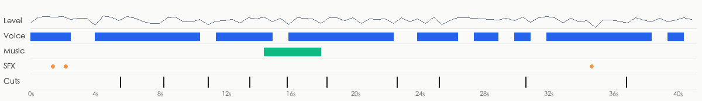

- Loudness -17.6 dBFS, peak -1.5 dBFS
- sound runs across cuts, laid in post as one bed (background changes 6.2dB at cuts vs 5.4dB within shots)
- Voice on 76% of the duration, pitch about 125.3Hz
- Voice source: human recording (human recording 73%, TTS voice-over 20%, native dialogue from the AI video model 7%)
  - 100% of the picture is live footage: the voice is most likely location sound or a human voice-over

## Open questions

- Shot #3 (8.3–11.0s): live action at only 56% confidence, runner-up AI-generated video
- Shot #6 (15.9–18.4s): live action at only 58% confidence, runner-up screen recording / screenshot
- No AI listened to the soundtrack (the review covered the picture only): real voice versus TTS is inferred from the waveform; the effects were found on the separated effects track and their types are estimated from the sound. Play the stems and each effect under “Sound” to check

# Part two · Remake plan

## Remake it yourself: do it in this order

Copy the method and the rhythm, not the pictures: keep what each part does and fill it with your own content and material.

This is a talking head. Do the steps in this order; the detail for each is in the matching subsection below.

1. **Write the content**: write yours in the same 5 steps as the original (narrative line under “Content and structure”)
2. **Shoot**: phone held vertical, mostly close-up; light: soft frontal light (flat light) — a large source from the camera side, almost no shadow on the subject: facing a window, a ring light, or a big softbox behind the camera, 18-inch ring light or a diffused LED panel just behind and above the phone; grade: natural (close to the original colours) (setups under “Shoot”)
3. **Voice**: the original is human recording; record it yourself or use TTS; delivery per “Acting and emotion”
4. **Edit**: follow the order and lengths in the shot list; the original has 11 shots at 3.8s each; 1 transitions under “Edit”
5. **Subtitles and styled text**: timing and style under “Packaging layer”
6. **Put it together and compare**: hand the shots you made to the agent; it places them on the original timeline, keeps the original where yours are missing, and renders a side-by-side comparison with the original

### Shoot

Shoot every shot of one scene before moving to the next; within a scene, shoot the wider sizes first and the close-ups last so the lighting is set only once. Leave about 1s of handle at both ends of every take.

**S1**: shots #1–#11 (41.27s on screen); Warehouse or industrial gym space: corrugated roof, red steel trusses, brick wal, Flat available light
- Lighting: soft frontal light (flat light), key light frontal, neutral (about 5000K)
- Setup medium shot · handheld · pull-out: shots #1, 5.57s on screen, shoot about 7.6s
- Setup medium shot · moving camera (gimbal / handheld pan) · pan / track: shots #6, 2.47s on screen, shoot about 4.5s
- Setup medium close-up · moving camera (gimbal / handheld pan) · pan / track/pull-out/push-in: shots #3–#5, 7.63s on screen, shoot about 13.6s
- Setup close-up · moving camera (gimbal / handheld pan) · pan / track/pull-out/push-in: shots #2, #7–#11, 25.6s on screen, shoot about 37.6s

### Acting and emotion

In a prompt, describe the visible expression and movement rather than words like “happy” or “sad”, and keep it smaller rather than bigger (strong emotion words tend to give mask faces and forced smiles); get the expression right in the first frame; for shots with lines, make the voice with its delivery first and let the picture act to it. For generated shots the Face and Movement below are already in the generation-unit prompts.

| Shot | Who | Emotion (strength) | Face | Movement / change | Delivery | How to get it |
|---|---|---|---|---|---|---|
| #2 | A | excited (medium) | eyes to camera, brows raised on key words, mouth open mid-speech | handheld selfie, free hand gesturing toward the lens | — | actor plays it |
| #7 | A | excited (medium) | eyes to camera, brows raised on key words, mouth open mid-speech | handheld selfie, free hand gesturing toward the lens | — | actor plays it |
| #8 | A | excited (medium) | eyes to camera, brows raised on key words, mouth open mid-speech | handheld selfie, free hand gesturing toward the lens | — | actor plays it |
| #9 | A | excited (medium) | eyes to camera, brows raised on key words, mouth open mid-speech | handheld selfie, free hand gesturing toward the lens | — | actor plays it |
| #10 | A | excited (medium) | eyes to camera, brows raised on key words, mouth open mid-speech | handheld selfie, free hand gesturing toward the lens | — | actor plays it |
| #11 | A | excited (medium) | eyes to camera, brows raised on key words, mouth open mid-speech | handheld selfie, free hand gesturing toward the lens | — | actor plays it |

- **actor plays it**: Filmed: hand the face, movement and delivery to the actor as direction, and rehearse the pauses and tone against the original once

### Edit

- Cut in the order and lengths of the shot list
- Approach: Product first, then face. Six shots on the real screen in the first 18 seconds, then one selfie take cut into five pieces with jump cuts. Hard cuts only, no graphics.
- Rhythm: 14.5 cuts per minute, 3.75s average live-action shot; 4 camera set-up(s) / location(s); 4 jump cut(s) and 0 punch-in(s) within the same set-up; inserts (screenshots / screen recordings / cards / stock) take 0%; 30% of cuts land in pauses of the speech; transitions cut×9, jump cut×1

## Appendix

### Shot by shot

Each shot has two parts: what is visible on screen, and how the tools infer it was made (with the basis); remake prompts last. Folded by default.

#1 00:00.000–00:05.567 · live action + code / editor overlays (text labels); brings in real material (live footage)

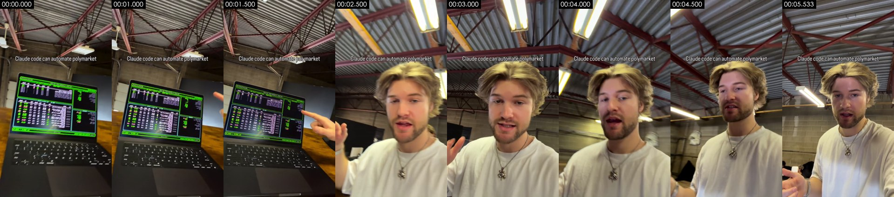

**Visible on screen** (check against the frames)
- Picture: Handheld phone shot looking down at an open laptop on a wooden surface. The screen shows a dark terminal-style dashboard with green and magenta tables. A small white caption sits above the laptop.
- Camera / lighting: medium shot; handheld; soft frontal light (flat light); key light frontal (from the camera side; both sides of the subject about equally bright); lighting ratio about 1.3:1 (0.3 stops); soft light (wide lit-to-shadow ramp)
- Text track (text/middle): Claude code can automate polymarket
- [AI assistant review] A real laptop filmed by a handheld phone: keyboard, trackpad and screen bezel in frame with perspective that shifts as the phone moves
- [AI assistant review] A real finger enters the frame and points at rows on the screen, with natural motion blur and skin detail
- [AI assistant review] Moire and glare on the screen and handheld shake: this is a camera filming a display, not a screen capture

**How it was made, as inferred by the tools** (inferred, not seen)
- Inference: live action 73%, AI-generated video 9%, film / TV footage 5% (fused_agent)
- Material: the user's real material: live footage
- Basis (tool measurements, not necessarily visible to the eye):
  - Photographic texture: noise σ=0.32, 168 colours, 3% flat blocks
  - Per-frame sharpness oscillates periodically (period 6 frames, correlation 0.04) with no duplicate frames: frame interpolation / rate conversion, or just the rhythm of a re-encode (transcodes whose platform tags were stripped show it too); not enough on its own to call AI

- Remake: Source is live action: reshoot per the shooting plan (shot size / camera setup / lighting); run rea-video plan --mode ai to remake with AI instead; real material the user must supply: live footage (whole frame)

#2 00:05.567–00:08.267 · live action + code / editor overlays (text labels); brings in real material (live footage)

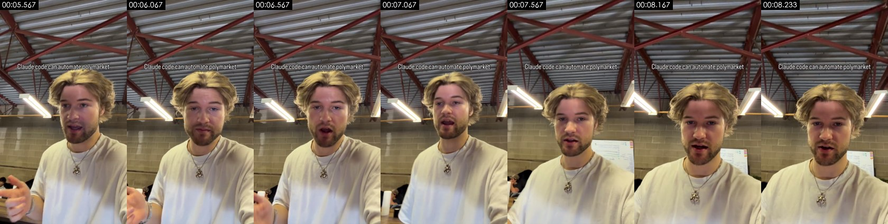

**Visible on screen** (check against the frames)
- Picture: Selfie in a warehouse space: the presenter talks to the lens and gestures with one hand. The same caption line stays at the top of frame.
- Acting: excited (medium) · eyes to camera, brows raised on key words, mouth open mid-speech
- Camera / lighting: close-up; moving camera (gimbal / handheld pan); three-quarter key + fill (standard set-up); key light frame right, three-quarter front; lighting ratio about 1.5:1 (0.6 stops); soft light (wide lit-to-shadow ramp)
- Text track (text/middle): Claude code can automate polymarket
- [AI assistant review] The same man (wavy blond-brown hair, short beard, white tee, pendant) and the same warehouse space with red steel roof trusses and brick wall appear across the selfie shots
- [AI assistant review] Handheld selfie framing with natural arm sway and parallax between his head and the roof trusses
- [AI assistant review] Hands pass close to the lens with real motion blur and correct fingers

**How it was made, as inferred by the tools** (inferred, not seen)
- Inference: live action 76%, AI-generated video 7%, film / TV footage 5% (fused_agent)
- Material: the user's real material: live footage
- Basis (tool measurements, not necessarily visible to the eye):
  - Photographic texture: noise σ=0.36, 147 colours, 1% flat blocks
  - The whole file is native 30fps and photographic shots carry no 24fps-source duplicate frames (100% of the duration): typical of straight-from-phone footage, generators mostly output 24fps
  - Temporal noise 1.81, 14% of pixels unchanged frame to frame: sensor noise is present, consistent with live action

- Remake: Source is live action: reshoot per the shooting plan (shot size / camera setup / lighting); run rea-video plan --mode ai to remake with AI instead; real material the user must supply: live footage (whole frame)

#3 00:08.267–00:11.000 · live action + code / editor overlays (subtitles, text labels); brings in real material (live footage)

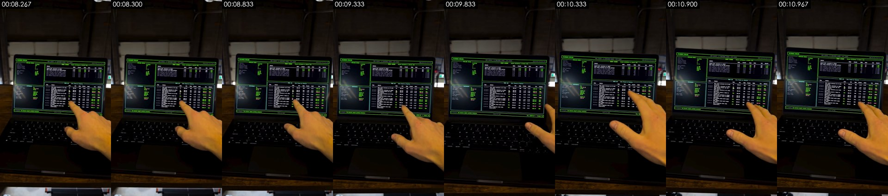

**Visible on screen** (check against the frames)
- Picture: Handheld phone shot of the laptop screen from above the keyboard. His finger points at rows of the dashboard table.
- Camera / lighting: medium close-up; moving camera (gimbal / handheld pan); night / low-light ambient, no dedicated fill; key light frontal (from the camera side; both sides of the subject about equally bright); lighting ratio about 1.2:1 (0.2 stops); medium-soft
- Text on objects in the scene (not subtitles): 21:11:1, 21:18:19, 21:11:29, 21:1排:19, 21:09:19, 21:18:29
- Text track (subtitle/bottom): D / ption
- Text track (subtitle/middle): 21:11:1 / 21:18:19 / 21:11:29 / 21:1:29
- Text track (subtitle/middle): 21:1排:19 / 21:09:19 / 21:18:29 / +52475.00
- Text track (subtitle/middle): 2026-040521:11:5907C / /1 / Liait / 4-04-0521:31:5uTc
- [AI assistant review] A real laptop filmed by a handheld phone: keyboard, trackpad and screen bezel in frame with perspective that shifts as the phone moves
- [AI assistant review] A real finger enters the frame and points at rows on the screen, with natural motion blur and skin detail
- [AI assistant review] Moire and glare on the screen and handheld shake: this is a camera filming a display, not a screen capture

**How it was made, as inferred by the tools** (inferred, not seen)
- Inference: live action 54%, AI-generated video 12%, screen recording / screenshot 12% (fused_agent)
- Material: the user's real material: live footage
- Basis (tool measurements, not necessarily visible to the eye):
  - OCR reads 6 lines of small text: the frame holds a UI / document screenshot
  - Rendered texture: 24% flat colour blocks, 95% of pixels use only 77 colours, 45% axis-aligned edges
  - Per-frame sharpness oscillates periodically (period 2 frames, correlation 0.23) with no duplicate frames: frame interpolation / rate conversion, or just the rhythm of a re-encode (transcodes whose platform tags were stripped show it too); not enough on its own to call AI

- Remake: Source is live action: reshoot per the shooting plan (shot size / camera setup / lighting); run rea-video plan --mode ai to remake with AI instead; real material the user must supply: live footage (whole frame)

#4 00:11.000–00:13.567 · live action + code / editor overlays (subtitles); brings in real material (live footage)

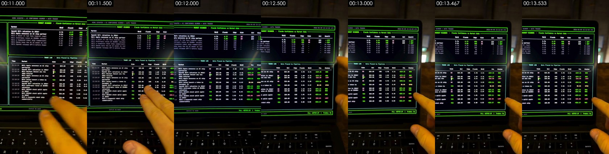

**Visible on screen** (check against the frames)
- Picture: Closer handheld shot of the dashboard table; his finger sweeps across the rows.
- Camera / lighting: medium close-up; moving camera (gimbal / handheld pan); night / low-light ambient, no dedicated fill; key light frontal (from the camera side; both sides of the subject about equally bright); lighting ratio about 1.3:1 (0.4 stops); soft light (wide lit-to-shadow ramp)
- Text on objects in the scene (not subtitles): Q, 公, DII, 5, R, 6
- Text track (subtitle/bottom): Ctrl+C to exit / Ctrl+Ctoexit / ctr+C to exit / ：.t
- Text track (subtitle/bottom): Q / 公 / DII / F4
- Text track (subtitle/bottom): 5 / R / 6 / 8
- Text track (subtitle/middle): openAr $iT+ voluatlon in 2026? / wilt Appte announce an AI chip partner / 0.76 / 0.77
- [AI assistant review] A real laptop filmed by a handheld phone: keyboard, trackpad and screen bezel in frame with perspective that shifts as the phone moves
- [AI assistant review] A real finger enters the frame and points at rows on the screen, with natural motion blur and skin detail
- [AI assistant review] Moire and glare on the screen and handheld shake: this is a camera filming a display, not a screen capture

**How it was made, as inferred by the tools** (inferred, not seen)
- Inference: live action 59%, AI-generated video 12%, screen recording / screenshot 11% (fused_agent)
- Material: the user's real material: live footage
- Basis (tool measurements, not necessarily visible to the eye):
  - OCR reads 12 lines of small text: the frame holds a UI / document screenshot
  - Per-frame sharpness oscillates periodically (period 4 frames, correlation 0.40) with no duplicate frames: frame interpolation / rate conversion, or just the rhythm of a re-encode (transcodes whose platform tags were stripped show it too); not enough on its own to call AI

- Remake: Source is live action: reshoot per the shooting plan (shot size / camera setup / lighting); run rea-video plan --mode ai to remake with AI instead; real material the user must supply: live footage (whole frame)

#5 00:13.567–00:15.900 · live action + code / editor overlays (subtitles, title); brings in real material (live footage)

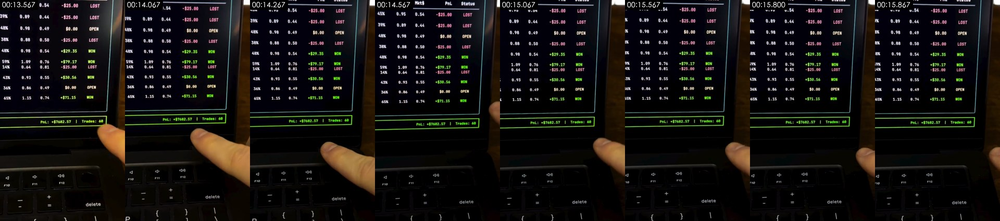

**Visible on screen** (check against the frames)
- Picture: Very close handheld shot of the right side of the table: percentages, profit and loss figures and WON / LOST / OPEN labels, his fingertip at the bottom edge.
- Camera / lighting: medium close-up; moving camera (gimbal / handheld pan); night / low-light ambient, no dedicated fill; key light frontal (from the camera side; both sides of the subject about equally bright); lighting ratio about 1.2:1 (0.2 stops); hard light (sharp shadow edge)
- Text on objects in the scene (not subtitles): F11, F12, F10, delete, 48%, 0.98
- Text track (subtitle/bottom): F11 / F12 / F10 / 10
- Text track (text/bottom): delete
- Text track (subtitle/middle): 48% / 0.98 / 0.54 / +$29.35
- Text track (subtitle/middle): 14% / 0.64 / 0.81 / -$25.00
- [AI assistant review] A real laptop filmed by a handheld phone: keyboard, trackpad and screen bezel in frame with perspective that shifts as the phone moves
- [AI assistant review] A real finger enters the frame and points at rows on the screen, with natural motion blur and skin detail
- [AI assistant review] Moire and glare on the screen and handheld shake: this is a camera filming a display, not a screen capture

**How it was made, as inferred by the tools** (inferred, not seen)
- Inference: live action 63%, 3D render 8%, code / template render 8% (fused_agent)
- Material: the user's real material: live footage
- Basis (tool measurements, not necessarily visible to the eye):
  - Rendered texture: 53% flat colour blocks, 95% of pixels use only 62 colours, 40% axis-aligned edges
  - The whole file is native 30fps and photographic shots carry no 24fps-source duplicate frames (100% of the duration): typical of straight-from-phone footage, generators mostly output 24fps

- Remake: Source is live action: reshoot per the shooting plan (shot size / camera setup / lighting); run rea-video plan --mode ai to remake with AI instead; real material the user must supply: live footage (whole frame)

#6 00:15.900–00:18.367 · live action + code / editor overlays (subtitles); brings in real material (live footage)

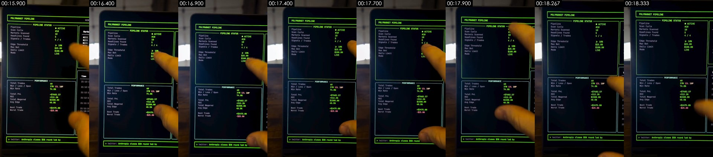

**Visible on screen** (check against the frames)
- Picture: Close handheld shot of the left panel of the dashboard (pipeline status and performance), his fingers pointing from the right.
- Camera / lighting: medium shot; moving camera (gimbal / handheld pan); night / low-light ambient, no dedicated fill; key light frontal (from the camera side; both sides of the subject about equally bright); lighting ratio about 1.3:1 (0.4 stops); hard light (sharp shadow edge)
- Text on objects in the scene (not subtitles): Best Trade, +$2475.00, 21:1, twitter:, Anthropic closes $sB round led by, Anthropic closes $5B round led by
- Text track (subtitle/bottom): Best Trade / +$2475.00 / 21:1 / Worst Trade
- Text track (subtitle/bottom): 21:1 / 21:16 / 21
- Text track (subtitle/bottom): twitter: / Anthropic closes $sB round led by / Anthropic closes $5B round led by / Anthropic closes $5B round teu uy
- Text track (subtitle/middle): #18 / Markets Scanned / 10 / Headlines Found
- [AI assistant review] A real laptop filmed by a handheld phone: keyboard, trackpad and screen bezel in frame with perspective that shifts as the phone moves
- [AI assistant review] A real finger enters the frame and points at rows on the screen, with natural motion blur and skin detail
- [AI assistant review] Moire and glare on the screen and handheld shake: this is a camera filming a display, not a screen capture

**How it was made, as inferred by the tools** (inferred, not seen)
- Inference: live action 56%, screen recording / screenshot 13%, AI-generated video 13% (fused_agent)
- Material: the user's real material: live footage
- Basis (tool measurements, not necessarily visible to the eye):
  - OCR reads 9 lines of small text: the frame holds a UI / document screenshot
  - Rendered texture: 40% flat colour blocks, 95% of pixels use only 119 colours, 54% axis-aligned edges
  - Per-frame sharpness oscillates periodically (period 2 frames, correlation 0.25) with no duplicate frames: frame interpolation / rate conversion, or just the rhythm of a re-encode (transcodes whose platform tags were stripped show it too); not enough on its own to call AI

- Remake: Source is live action: reshoot per the shooting plan (shot size / camera setup / lighting); run rea-video plan --mode ai to remake with AI instead; real material the user must supply: live footage (whole frame)

#7 00:18.367–00:22.733 · live action + code / editor overlays (text labels); brings in real material (live footage)

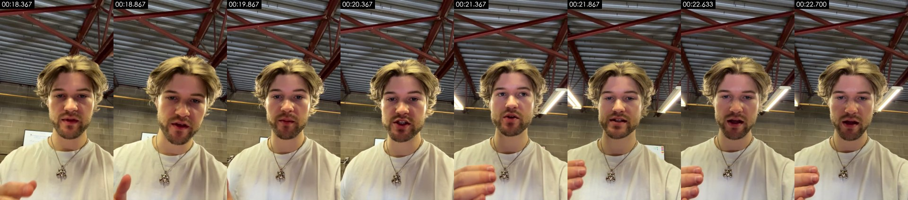

**Visible on screen** (check against the frames)
- Picture: Selfie, closer than before: the presenter talks to the lens, hand raised at the bottom of frame.
- Acting: excited (medium) · eyes to camera, brows raised on key words, mouth open mid-speech
- Camera / lighting: close-up; moving camera (gimbal / handheld pan); soft frontal light (flat light); key light frontal (from the camera side; both sides of the subject about equally bright); lighting ratio about 1.1:1 (0.2 stops); soft light (almost no lit / shadow edge)
- Text track (text/bottom): 3
- [AI assistant review] The same man (wavy blond-brown hair, short beard, white tee, pendant) and the same warehouse space with red steel roof trusses and brick wall appear across the selfie shots
- [AI assistant review] Handheld selfie framing with natural arm sway and parallax between his head and the roof trusses
- [AI assistant review] Hands pass close to the lens with real motion blur and correct fingers

**How it was made, as inferred by the tools** (inferred, not seen)
- Inference: live action 73%, AI-generated video 12%, AI avatar (talking head) 4% (fused_agent)
- Material: the user's real material: live footage
- Basis (tool measurements, not necessarily visible to the eye):
  - Photographic texture: noise σ=0.36, 165 colours, 2% flat blocks
  - Per-frame sharpness oscillates periodically (period 6 frames, correlation 0.25) with no duplicate frames: frame interpolation / rate conversion, or just the rhythm of a re-encode (transcodes whose platform tags were stripped show it too); not enough on its own to call AI

- Remake: Source is live action: reshoot per the shooting plan (shot size / camera setup / lighting); run rea-video plan --mode ai to remake with AI instead; real material the user must supply: live footage (whole frame)

#8 00:22.733–00:25.333 · live action; brings in real material (live footage)

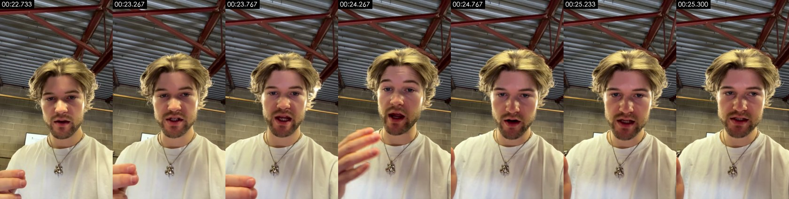

**Visible on screen** (check against the frames)
- Picture: Same selfie framing, a jump cut later in the take.
- Acting: excited (medium) · eyes to camera, brows raised on key words, mouth open mid-speech
- Camera / lighting: close-up; moving camera (gimbal / handheld pan); soft frontal light (flat light); key light frontal (from the camera side; both sides of the subject about equally bright); lighting ratio about 1.1:1 (0.1 stops); soft light (almost no lit / shadow edge)
- [AI assistant review] The same man (wavy blond-brown hair, short beard, white tee, pendant) and the same warehouse space with red steel roof trusses and brick wall appear across the selfie shots
- [AI assistant review] Handheld selfie framing with natural arm sway and parallax between his head and the roof trusses
- [AI assistant review] Hands pass close to the lens with real motion blur and correct fingers

**How it was made, as inferred by the tools** (inferred, not seen)
- Inference: live action 73%, AI-generated video 12%, AI avatar (talking head) 4% (fused_agent)
- Material: the user's real material: live footage
- Basis (tool measurements, not necessarily visible to the eye):
  - Photographic texture: noise σ=0.36, 177 colours, 2% flat blocks
  - Per-frame sharpness oscillates periodically (period 2 frames, correlation 0.19) with no duplicate frames: frame interpolation / rate conversion, or just the rhythm of a re-encode (transcodes whose platform tags were stripped show it too); not enough on its own to call AI

- Remake: Source is live action: reshoot per the shooting plan (shot size / camera setup / lighting); run rea-video plan --mode ai to remake with AI instead; real material the user must supply: live footage (whole frame)

#9 00:25.333–00:30.700 · live action; brings in real material (live footage)

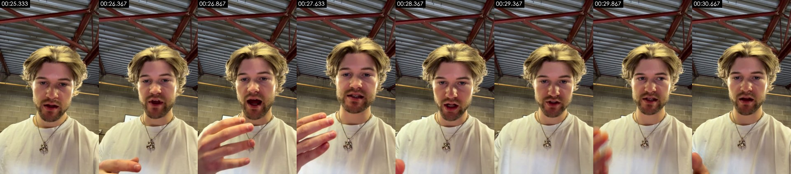

**Visible on screen** (check against the frames)
- Picture: Same selfie framing, continuing.
- Acting: excited (medium) · eyes to camera, brows raised on key words, mouth open mid-speech
- Camera / lighting: close-up; moving camera (gimbal / handheld pan); soft frontal light (flat light); key light frontal (from the camera side; both sides of the subject about equally bright); lighting ratio about 1.1:1 (0.1 stops); soft light (almost no lit / shadow edge)
- [AI assistant review] The same man (wavy blond-brown hair, short beard, white tee, pendant) and the same warehouse space with red steel roof trusses and brick wall appear across the selfie shots
- [AI assistant review] Handheld selfie framing with natural arm sway and parallax between his head and the roof trusses
- [AI assistant review] Hands pass close to the lens with real motion blur and correct fingers

**How it was made, as inferred by the tools** (inferred, not seen)
- Inference: live action 73%, AI-generated video 12%, AI avatar (talking head) 4% (fused_agent)
- Material: the user's real material: live footage
- Basis (tool measurements, not necessarily visible to the eye):
  - Photographic texture: noise σ=0.38, 179 colours, 2% flat blocks
  - Per-frame sharpness oscillates periodically (period 6 frames, correlation 0.16) with no duplicate frames: frame interpolation / rate conversion, or just the rhythm of a re-encode (transcodes whose platform tags were stripped show it too); not enough on its own to call AI

- Remake: Source is live action: reshoot per the shooting plan (shot size / camera setup / lighting); run rea-video plan --mode ai to remake with AI instead; real material the user must supply: live footage (whole frame)

#10 00:30.700–00:36.933 · live action; brings in real material (live footage)

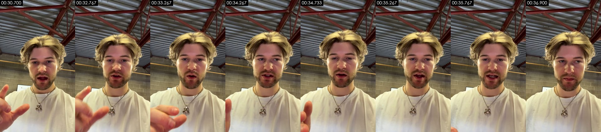

**Visible on screen** (check against the frames)
- Picture: Same selfie framing; his open hand comes up toward the lens.
- Acting: excited (medium) · eyes to camera, brows raised on key words, mouth open mid-speech
- Camera / lighting: close-up; moving camera (gimbal / handheld pan); soft frontal light (flat light); key light frontal (from the camera side; both sides of the subject about equally bright); lighting ratio about 1.0:1 (0.1 stops); soft light (almost no lit / shadow edge)
- [AI assistant review] The same man (wavy blond-brown hair, short beard, white tee, pendant) and the same warehouse space with red steel roof trusses and brick wall appear across the selfie shots
- [AI assistant review] Handheld selfie framing with natural arm sway and parallax between his head and the roof trusses
- [AI assistant review] Hands pass close to the lens with real motion blur and correct fingers

**How it was made, as inferred by the tools** (inferred, not seen)
- Inference: live action 73%, AI-generated video 12%, AI avatar (talking head) 4% (fused_agent)
- Material: the user's real material: live footage
- Basis (tool measurements, not necessarily visible to the eye):
  - Photographic texture: noise σ=0.40, 190 colours, 2% flat blocks
  - Per-frame sharpness oscillates periodically (period 2 frames, correlation 0.11) with no duplicate frames: frame interpolation / rate conversion, or just the rhythm of a re-encode (transcodes whose platform tags were stripped show it too); not enough on its own to call AI

- Remake: Source is live action: reshoot per the shooting plan (shot size / camera setup / lighting); run rea-video plan --mode ai to remake with AI instead; real material the user must supply: live footage (whole frame)

#11 00:36.933–00:41.267 · live action + code / editor overlays (styled text); brings in real material (live footage)

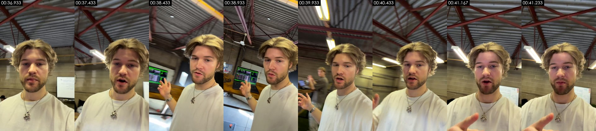

**Visible on screen** (check against the frames)
- Picture: Same selfie framing for the closing line.
- Acting: excited (medium) · eyes to camera, brows raised on key words, mouth open mid-speech
- Camera / lighting: close-up; moving camera (gimbal / handheld pan); three-quarter key + fill (standard set-up); key light frame right, three-quarter front; lighting ratio about 1.5:1 (0.6 stops); soft light (wide lit-to-shadow ramp)
- Text track (text/middle): 6
- [AI assistant review] The same man (wavy blond-brown hair, short beard, white tee, pendant) and the same warehouse space with red steel roof trusses and brick wall appear across the selfie shots
- [AI assistant review] Handheld selfie framing with natural arm sway and parallax between his head and the roof trusses
- [AI assistant review] Hands pass close to the lens with real motion blur and correct fingers

**How it was made, as inferred by the tools** (inferred, not seen)
- Inference: live action 73%, AI-generated video 12%, AI avatar (talking head) 4% (fused_agent)
- Material: the user's real material: live footage
- Basis (tool measurements, not necessarily visible to the eye):
  - Photographic texture: noise σ=0.30, 159 colours, 4% flat blocks
  - Per-frame sharpness oscillates periodically (period None frames, correlation 0.00) with no duplicate frames: frame interpolation / rate conversion, or just the rhythm of a re-encode (transcodes whose platform tags were stripped show it too); not enough on its own to call AI

- Remake: Source is live action: reshoot per the shooting plan (shot size / camera setup / lighting); run rea-video plan --mode ai to remake with AI instead; real material the user must supply: live footage (whole frame)

### Metadata clues

- Encoder: `Lavf62.12.100`

### Notes

- Deterministic forensics is reliable on motion, whole-frame pan/zoom, rendered texture and 24→30 fps conversion; telling live action from AI from 3D needs image reading (a VLM or an AI assistant's review), and a look at the frames yourself.
- Platform transcoding usually strips metadata; missing metadata proves nothing.
- The full data is in `breakdown.json`; the package for models starts at `VIDEO.md`.

---

Made with [REA-VIDEO](https://github.com/JuneYaooo/rea-video) · https://github.com/JuneYaooo/rea-video
