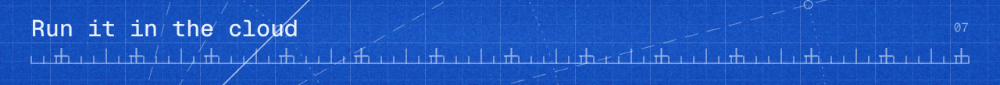

<p align="center"></p>

# Run big batches on FounderOS computers

One video takes a few minutes on a laptop. That is fine. A batch is different: 50 videos is hours of your
computer measuring frames and separating sound, and your AI reviewing every shot by eye.

FounderOS computers are cloud computers your AI agents work on. You give one the list of links, close the
laptop, and come back to a folder of breakdowns.

## When it is worth it

- You want to study an account or a niche: its top 20 to 100 videos, compared.
- You run breakdowns every week and do not want them on your own machine.
- You edit videos with AI as well. The same computers render the edits. That is how the videos on
  [@brodyautomates](https://instagram.com/brodyautomates) are made: see the
  [Blender Edit Machine](https://github.com/brodyautomates/blender-edit-machine) and the demo at the top of its README.

## Setup

1. **Sign up** at [founderos.sh](https://founderos.sh) and open a computer.
2. **Get the repo onto it:**
   ```bash
   git clone https://github.com/brodyautomates/video-breakdown-machine
   cd video-breakdown-machine && python3 breakdown_machine/install.py
   ```
3. **Start Claude Code in the folder** (`claude`) and give it your list:
   ```
   Break down each of these videos, review every shot, then compare them all:
   <one link per line>
   ```
4. **Download** the `runs/` folder, or just `patterns/PATTERNS.md` and the reports you want.

To go faster, open several computers and give each a part of the list. Each breakdown is its own folder, so
copying the `runs/` folders together is all the joining there is.
