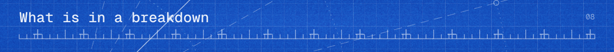

<p align="center"></p>

# What is in a breakdown

Every breakdown is one folder. Two files matter most: `report.html` is for you, `VIDEO.md` is for your AI.

```
runs/my-video/
  report.html        the report: verdict, shot table, camera, light, captions, sound, remake plan
  VIDEO.md           the front page for an AI: verdict, open questions and a map of the files below
  video/
    timeline.md      one line per shot: time, how it was made, what happens
    content.md       what it says and how it is structured
    rhythm.md        when the cuts land, shot lengths, key frames
    look.md          framing, camera, lighting and grade for filmed shots
    packaging.md     captions, styled text, stickers: timing and style
    sound.md         voice, music, sound effects and what each one lands on
    remake.md        what each shot needs if you rebuild it
    shots/01.md ...  everything about one shot
  shots/             first frame, last frame and a contact sheet per shot
  storyboard.jpg     the whole video on one sheet
  stems/  sfx/       the voice, music and effects split apart; a clip of each sound effect
  packaging/         the captions as subtitle files
  breakdown.json     all the raw measurements, for programs
  skill/SKILL.md     the editing skill, once you ask for it
```

## Why it is split up

A full breakdown is hundreds of thousands of tokens. An AI that loads all of it has no room left to think.
`VIDEO.md` is a few hundred tokens with a map that says what each file holds and how big it is, so the AI opens
only the file a question needs.

`VIDEO.md` is an open format, not ours: the spec is at [videomd.github.io/videomd](https://videomd.github.io/videomd/).
The engine that writes it is [rea-video](https://github.com/JuneYaooo/rea-video).

## How much to trust each kind of value

| Kind | Examples | Trust |
|---|---|---|
| Measured | cut times, shot lengths, caption timing, loudness, colour | High. Computed from the file |
| Seen | what is in the frame, who is on screen, what the text says | High after the visual review |
| Inferred | camera position, light distance, lens, why an editor made a choice | A reading. Use it as a starting point |

The verdict "filmed or AI" is measured first and then checked by eye in the review. On a video downloaded from
Instagram or TikTok, trust it only after the review.
